# Outfit Grader

한 아바타 전용 의상·소품을 **체형이 전혀 다른 아바타**에 옮겨 주는 Unity 에디터 도구입니다.
이름은 의류 업계에서 기준 패턴을 사이즈별로 늘리고 줄이는 그레이딩(grading)에서 따왔습니다. 이전 이름은 Mini Outfit Fitter입니다.
VRChat 아바타 의상 변환 도구(예: きせった Kisetter)의 원리를 이해하려고 직접 만든 축소판입니다.
사용자 후기에서 반복해서 나온 불편(이해하기 어려운 오류, 머리 부착물 깨짐, 체형 차이로 옷이 몸에 묻힘)을 해결하는 데 집중했습니다.

지원 범위는 **모자·상의·안경**입니다. 구조를 단순하게 유지하려고 손 소품(반지·장갑)과 하의·신발은 다루지 않습니다.

- Unity 2022.3 LTS (개발 2022.3.62f3, VRChat 기준 버전 2022.3.22f1과 같은 LTS)
- 외부 패키지 의존 없음 (Unity 기본 API만 사용)
- EditMode 테스트 211개 (2026-11-25 실행, 전부 통과)

## 현재 결과 (기본 설정, 2026-11-25)

| 항목 | Lumelana (인간형) | inuinu (치비) |
|---|---|---|
| 몸이 뚫은 후드티 삼각형 | 86 (모두 후드, 머리카락 아래라 보이지 않음) | 237 |
| 옷 모양 | 원본 비율 그대로 | 형태 검사로 엉덩이에서 끝나는 후드티 |
| 의상 6개 맞추기 시간 | 약 530ms (두 아바타, 3회 중앙값) | |

아래 절의 수치는 각 기능을 넣은 당시의 측정값이라, 이후 단계가 더해진 지금 결과(위 표)와 다를 수 있습니다.

## 시연

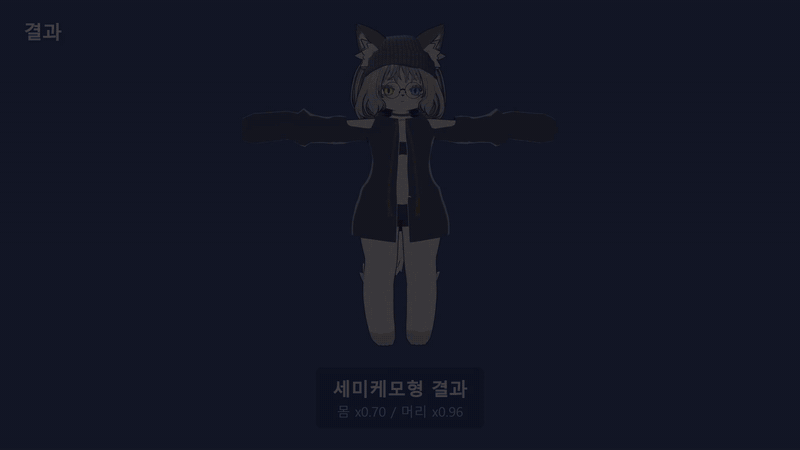

기능별 작동 원리는 아래 [기능](#기능) 절에 처리 순서대로 GIF로 정리했습니다(장마다 같은 구도에서 적용 전 -> 작동 표시 -> 적용 후, 1.5배속).
전체 영상(2분 5초, 소리 없음)은 [`docs/videos/outfit-grader-explain.mp4`](docs/videos/outfit-grader-explain.mp4), 편집 원본은 [`Tools/DemoVideo`](Tools/DemoVideo/README.md)에 있습니다.

시연 모델: フェリス (リュクらぼ), Lumelana (Murixir workshop), inuinu いぬいぬ (zuchicorn), ニット帽 (TRIM), フェリスちゃん用メガネ (MT-Shop)

### 결과 비교 이미지

**1. 소품**: フェリス(リュクらぼ) 전용 안경을 치비 체형 시바견 아바타 inuinu(zuchicorn)에 옮긴 결과입니다.

| 원본: フェリス + 전용 안경 | 그냥 끌어다 놓은 경우 | Outfit Grader |
|---|---|---|
| 안경이 눈에 맞게 걸쳐 있음 | 안경이 フェリス 눈높이(약 1m) 허공에 떠 있음 | 안경이 강아지 두 눈을 감싸고 브리지가 주둥이에 걸림 |

| 그냥 끌어다 놓은 경우 | Outfit Grader |
|---|---|
| 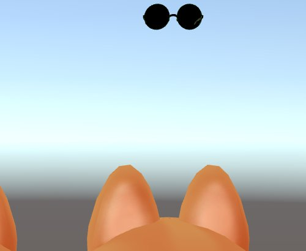 | 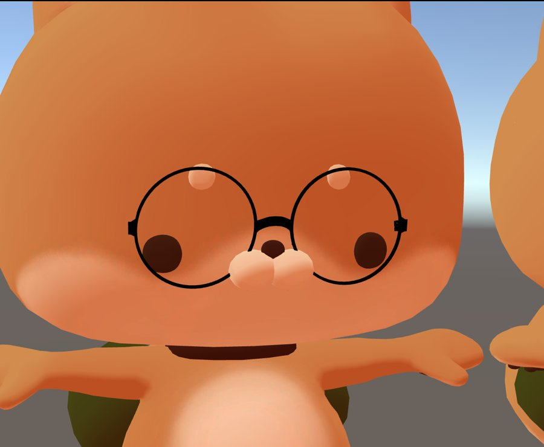 |

시연 모델: inuinu (zuchicorn)

**2. 모자·상의·안경 한 번에**: フェリス에 씌운 니트 모자(TRIM), フェリス 후드티, 전용 안경 3개를 인간형 Lumelana(Murixir workshop)와 inuinu에 한 번에 입힌 결과입니다.

| 원본: フェリス | Lumelana (인간형, 머리 x0.96) | inuinu (치비 강아지, 머리 x1.68) |
|---|---|---|
| 니트 모자가 머리카락 위에, 안경이 눈에 맞게 씌워짐 | 모자·안경이 머리 크기에 맞게 줄어 같은 자리에 씌워지고, 후드티가 몸 위로 입혀짐 | 모자가 큰 머리에 맞게 커져 이마에 걸리고, 안경이 두 눈을 감쌈 |

| 원본: フェリス | Lumelana에 입힌 결과 |
|---|---|
| 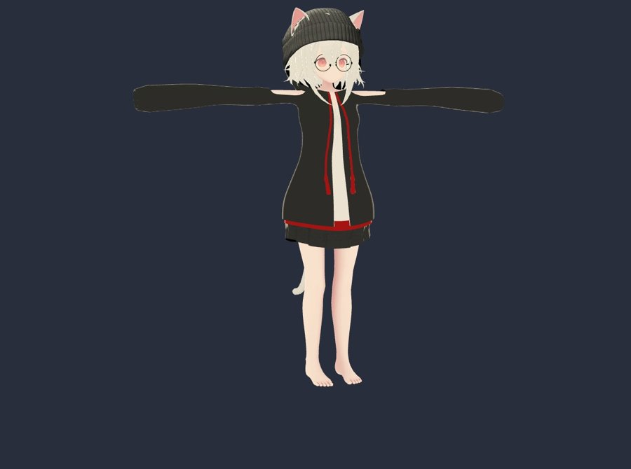 | 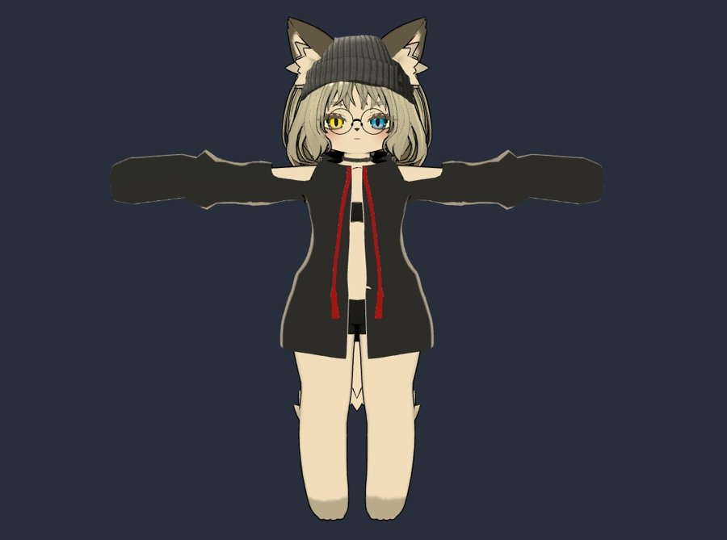 |

니트 모자는 Armature 없이 블렌드쉐이프만 가진 메시라, 처음에는 "깨진 의상"으로 막혔습니다. 지금은 안경과 같은 소품으로 다룹니다.

**두상 맞춤과 귀 구멍**: 크기만 맞추면 두상이 다른 대상에서 머리가 모자를 뚫고 보이고, 고양이 귀가 모자를 그대로 관통합니다. 모자를 머리 표면 바깥으로 밀어 두상에 맞추고, 귀가 뚫고 지나가는 자리의 모자 삼각형만 지워 귀가 구멍으로 나오게 합니다.

| 측정 (모자 정점 1,316개, 삼각형 2,012개) | Lumelana 보정 전 -> 후 | inuinu 보정 전 -> 후 |
|---|---|---|
| 머리 표면 안쪽에 있는 모자 정점 | 113 -> 87 | 217 -> 4 |
| 귀 구멍으로 지운 삼각형 | 0 -> 39 (1.9%) | 0 -> 34 (1.7%) |

Lumelana에 남은 값은 머리카락 가닥(머리 본에 묶여 몸 표면으로 잡힘)의 법선이 제각각이라 생기는 판정 잡음으로, 정면 화면에서는 보이지 않습니다.

**3. 상의 맞춤 단계별 비교 (Lumelana)**

| 마디별 굵기 맞춤 전 | 마디별 굵기 맞춤 후 | 관통 밀어내기 후 | 표면 간격 보존 후 |
|---|---|---|---|
| 몸 비율 하나(0.70배)로 줄인 후드티가 Lumelana 몸 안에 묻혀 소매 끝과 후드만 보임 | 후드티 몸통과 소매 전체가 몸 위로 보임 | 가슴에서 몸이 옷을 뚫던 부분이 옷 아래로 들어감(후드티 정점 1,759개 보정, inuinu는 524개) | 소매가 매끈해지고 속옷(브라)이 후드티를 뚫던 자리가 사라짐. 몸·속옷이 뚫은 후드티 삼각형 293 -> 86개(남은 86개는 모두 후드) |

| 관통 밀어내기·표면 간격 보존 끔 | 기본 설정(표면 간격 보존 켬) |
|---|---|
| 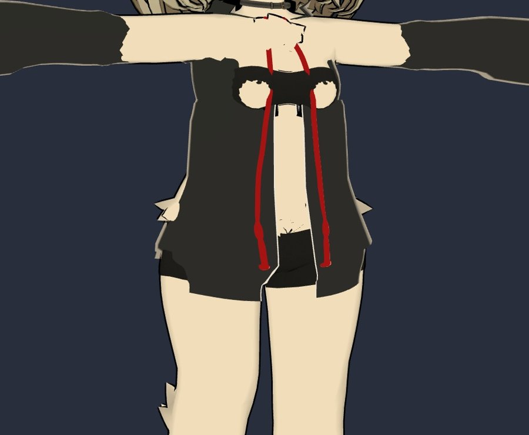 |  |

> 시연 이미지는 모델 규약 확인(2026-11-25) 뒤 넣었습니다. inuinu 이미지는 UV License에 따라 저작자(zuchicorn)와 모델명을 표기합니다.
> 모델 파일은 저장소에 포함하지 않습니다. 출처와 규약 확인 기록은 저장소에 올리지 않는 로컬 문서로 관리합니다.

## 기능

처리 순서대로 정리했습니다. GIF의 빨간 점은 몸 안에 묻힌 옷 정점(목 아래)입니다.

### 1. 실행 전 진단

문제마다 **문제 / 원인 / 해결 방법**을 한국어로 보여줍니다. 오류가 있으면 실행 버튼이 잠깁니다. 진단과 본 연결 표는 의상마다 따로 보여 줍니다.

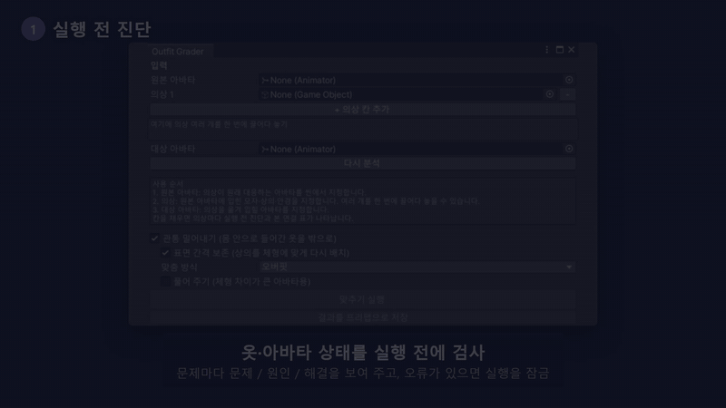

### 2. 본 연결

두 아바타에서 같은 색이 서로 연결된 부위입니다.

- **본 매칭**: Humanoid 매핑 -> 이름 정규화(VRoid `J_Bip_L_UpperArm`, Mixamo `LeftArm`, MMD `左腕`, Blender `UpperArm.L`) 순서로 연결합니다.
- **대체 연결**: 대상에 손가락 본이 없으면 손 본에 붙이는 식으로 가장 가까운 부모 Humanoid 본에 연결합니다.
- **의상 전용 본 보존**: 치마·리본·꼬리처럼 원본 아바타에 없는 본은 부모 본을 따라 그대로 옮깁니다.


### 3. 크기 맞춤

- **구역별 크기 보정**: 몸(엉덩이 높이)과 머리(실제 메시 폭)를 따로 재서 비율을 정합니다. 치비처럼 몸은 작고 머리는 큰 경우를 위함입니다.
- **마디별 굵기 맞춤**: 상의가 덮는 팔·몸통 마디마다 두 아바타의 몸 단면 굵기와 길이를 재서, 의상 본을 길이 방향과 단면 방향으로 따로 맞춥니다. 몸 비율 하나로 줄이면 옷이 몸 안에 묻히는 문제를 줄입니다. 소맷부리가 매달린 손 본은 아래팔 굵기 배율로 균등하게 맞춰 소맷부리가 소매보다 작게 오그라들지 않게 합니다.


### 4. 소품 부착

- **본 없는 소품 부착**: Armature 없는 안경·모자(MeshRenderer, 또는 블렌드쉐이프로 크기만 조정하는 본 없는 SkinnedMeshRenderer)는 원래 놓인 본, 없으면 메시에서 가장 가까운 큰 본에 붙입니다.
- **얼굴 표면 배치**: 소품을 머리 구역 안 같은 상대 위치로 옮긴 뒤, 원본에서 얼굴 앞면과 떨어져 있던 간격을 대상 얼굴 앞면 기준으로 유지합니다.


### 5. 관통 밀어내기

맞춘 뒤에도 몸 안으로 들어간 의상 정점을 대상 몸 표면 바깥으로 밀어낸 새 메시로 교체합니다(원본 메시는 그대로). 정수리를 덮는 모자는 두상에 맞추고 귀가 뚫고 지나가는 자리에, 옷은 꼬리가 뚫고 지나가는 자리에 구멍을 냅니다. 수인·퍼리 아바타의 메시 털 중 옷에 가려지는 털 묶음은 숨깁니다. 안경처럼 정수리를 덮지 않는 소품은 건드리지 않습니다. 새 메시는 프리팹 저장 때 `Assets/OutfitGrader_Output/Meshes/`에 저장되므로, Ctrl+Z로 되돌려도 쓰레기 에셋이 남지 않습니다. 창에서 끌 수 있습니다.


### 6. 표면 간격 보존

상의 몸통·소매 정점을 원본 몸과 떨어져 있던 간격 그대로 대상 몸 표면 기준으로 다시 놓습니다. 가슴 크기·몸통 단면 모양이 달라도 옷이 몸을 따라가고, 셔츠와 겉옷처럼 겹친 층의 순서를 지킵니다. 후드·손 부분은 관통 밀어내기를 씁니다. 창에서 끌 수 있습니다(기본 켬). 맞춤 방식으로 오버핏(기본)과 정사이즈를 고릅니다. 체형 차이가 작으면 두 방식 결과가 같습니다.

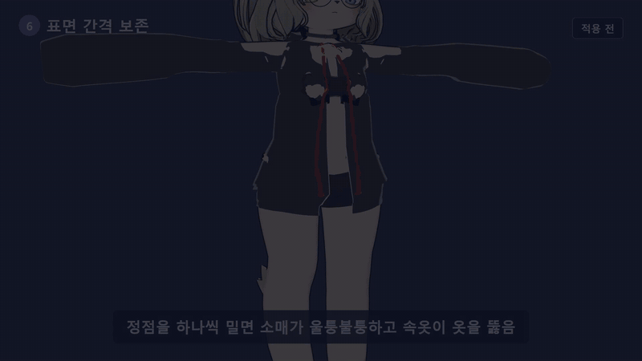

### 7. 풀어 주기 (치비용, 기본 끔)

팔·몸통이 짧은 치비 아바타에서 몸통·소매를 짧게 풀어 길이로 크게 눌린 곳의 날카로운 접힘을 펴고, 아랫단은 엉덩이까지만 늘입니다. 아바타당 약 1~2초 더 걸립니다.


### 8. 대상에 바로 입히기 · 여러 의상 한 번에

- **대상에 바로 입히기**: Modular Avatar·키세타처럼 의상 복제본을 대상 아바타 안에 넣습니다. 원본 의상은 바꾸지 않고, 대상 아바타의 변경은 Ctrl+Z 한 번으로 전부 되돌립니다. 같은 의상을 다시 입히려 하면 겹침을 경고합니다.
- **여러 의상 한 번에**: 의상 칸이 목록이라 여러 의상·소품을 한 번에(여러 개 끌어다 놓기 지원) 입히고, Ctrl+Z 한 번에 전부 되돌립니다. 실행 뒤 변경 보고서에 본마다 옮긴 방식과 배율이 남습니다.


같은 장면에서 맞추기 전 -> 실행 후 -> Ctrl+Z 한 번 뒤를 비교하면 대상 아바타가 원래 상태로 돌아갑니다(대상 아바타의 오브젝트 수 77개로 맞추기 전과 같음).

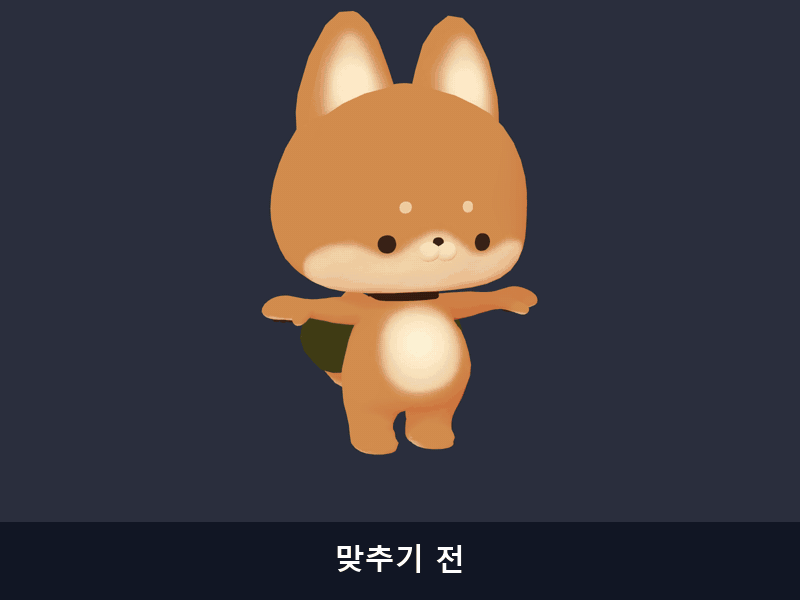

### 9. 직접 수정

본 연결 표에서 대상 본을 바꾸거나, 측정한 몸·머리 배율에 조정 배율(0.5~2배)을 곱할 수 있습니다. 아래는 같은 치비 대상에서 머리 배율 조정을 1, 1.25, 0.8로 바꿔 다시 맞춘 결과입니다.

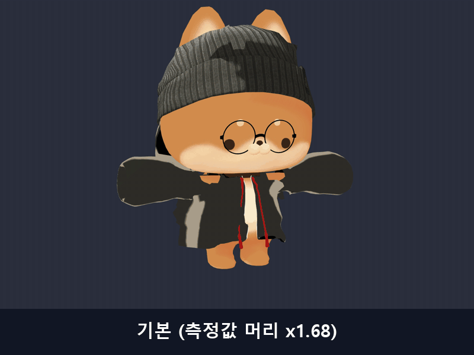

### 그 밖의 기능

| 기능 | 설명 |
|---|---|
| 프리팹 저장 | 의상을 입힌 아바타를 `Assets/OutfitGrader_Output/<아바타>_<의상>.prefab`으로 저장합니다. 씬의 아바타와 원래 프리팹 에셋은 그대로이며, VRChat SDK가 없는 프로젝트의 빈 스크립트는 저장본에서만 제거합니다. |

## 사용법

1. 원본 아바타와 대상 아바타를 씬에 놓습니다. 둘 다 Humanoid로 설정되어 있어야 합니다.
2. `Tools > Outfit Grader`를 엽니다.
3. **원본 아바타**, **의상**(원본 아바타에 입힌 모자·상의·안경 오브젝트, 여러 개 가능. 프리팹 에셋은 원본 아바타 안에 먼저 놓습니다), **대상 아바타**를 지정합니다.
4. 진단과 본 연결 표를 확인하고, 필요하면 대상 본이나 배율을 고칩니다.
5. **맞추기 실행**을 누르면 대상 아바타 안에 의상이 들어갑니다. 결과가 마음에 들지 않으면 Ctrl+Z 한 번으로 되돌립니다.
6. 마음에 들면 **결과를 프리팹으로 저장**을 누릅니다.

## 기존 도구 후기에서 출발한 설계

| 후기에서 나온 불편 | 이 도구의 대응 | 남은 한계 |
|---|---|---|
| 오류 문구가 내부 용어라 원인을 모름 | 실행 전 진단으로 원인과 해결 방법을 먼저 안내 | 진단 규칙에 없는 상황은 잡지 못함 |
| 모자·안경 등 머리 부착물이 깨짐 | 머리 구역을 따로 측정하고 얼굴 표면 기준으로 배치 | 손 소품(반지·장갑)은 범위 밖 |
| 축소 블렌드쉐이프가 켜져 있으면 결과가 틀어짐 | 측정에 블렌드쉐이프를 쓰지 않고, 켜져 있으면 안내 | - |
| 변환 후 위치를 고칠 수 없음 | 결과 본이 일반 Transform이라 직접 조정 가능, 배율 슬라이더 제공 | - |

몸 의상은 마디별 굵기·길이 맞춤, 표면 간격 보존, 관통 밀어내기까지 지원합니다. 옷 전체를 천 시뮬레이션으로 다시 계산하지는 않습니다. 체형 차이가 큰 치비용 풀어 주기 옵션(기본 끔)에서만 몸통·소매를 위치 기반 반복으로 짧게 다듬습니다. 비슷한 BOOTH 도구 중 ポンきせ는 본 방향·길이까지만 맞추고 굵기 차이는 고치지 않으며, Outfit Refit·OutFitter는 메시 자체를 변형합니다. 이 도구는 그 사이 단계입니다.

## 동작 원리

### 한눈에 보기

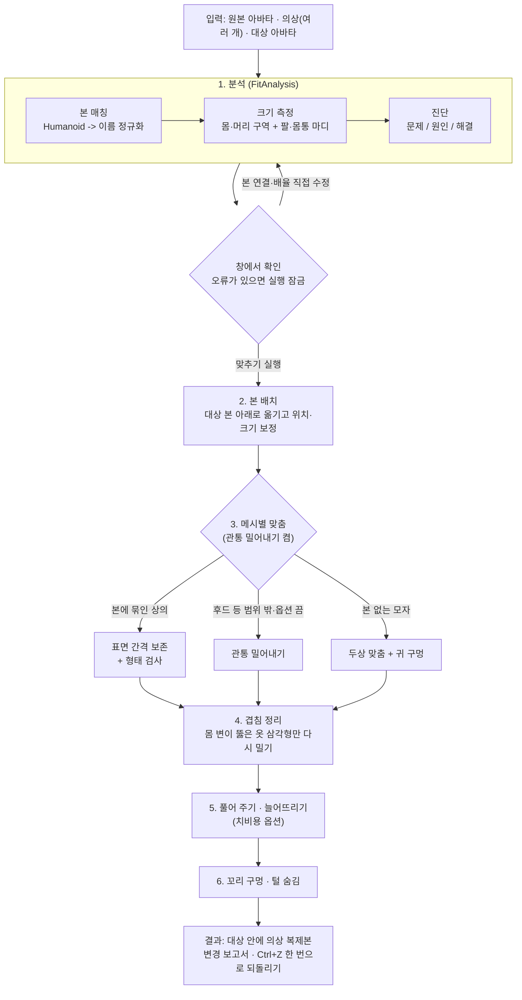

### 단계별 요약

| 단계 | 무엇을 하나 | 왜 필요한가 | 대표 수치 |
|---|---|---|---|
| 본 매칭 | 의상 본을 Humanoid 매핑 -> 이름 정규화 순서로 대상 본에 연결 | 아바타마다 본 이름 규칙이 다름 | Humanoid 15개 · 소품 2개 연결 (후드티 등 3개 -> 세미케모형) |
| 크기 측정 | 몸(엉덩이 높이)·머리(얼굴 폭)·팔/몸통 마디 단면을 따로 잼 | 치비는 몸은 작고 머리는 큼 | inuinu 몸 x0.22, 머리 x1.68 |
| 본 배치 | `대상 본 + (의상 본 - 원본 본) x 구역 비율`, 마디마다 길이·굵기 배율 | 비율 하나로 줄이면 옷이 몸에 묻힘 | 묻힌 정점 2,700 -> 797 (목 아래, 세미케모형) |
| 소품 부착 | 머리 구역 상자 안 같은 상대 위치 + 얼굴 앞 간격 유지 | 안경이 원본 눈높이 허공에 뜸 | 머리 구역 비율 x1.68 (inuinu) |
| 표면 간격 보존 | 몸을 원통 표로 재고, 옷 정점을 원본과 같은 간격으로 대상 표면에 다시 놓음 | 정점별 밀기는 층 순서가 뒤집히고 소매가 울퉁불퉁 | 몸·속옷이 뚫은 후드티 삼각형 293 -> 86 (Lumelana) |
| 형태 검사 | 3배 이상 눌린 면이 15%를 넘는 부위는 상한을 낮춰 다시 배치 | 형태 보존이 최우선 원칙 | 무너진 inuinu 부위 24~64% -> 엉덩이에서 끝나는 후드티 |
| 관통 밀어내기 | 몸 표면 안쪽 정점을 바깥으로 밀고 주변 두 고리에 나눠 줌 | 범위 밖(후드)·옵션 끔일 때의 기본 보정. 모자는 두상에 맞춤 | 모자 머리 안쪽 정점 217 -> 4 (inuinu) |
| 겹침 정리 | 몸 변이 실제로 뚫은 옷 삼각형만 찾아 최대 12번 밀기 | 정점-평면 판정은 넓은 면을 뚫는 볼록한 속옷 컵을 놓침 | 매 회 몸통 반지름의 3.7%씩 |
| 풀어 주기·늘어뜨리기 | 크게 눌린 접힘을 펴고, 남는 천을 중력처럼 아래로 | 치비의 짧은 팔·몸통 | inuinu 몸 관통 272 -> 185 |
| 꼬리 구멍·털 숨김 | 꼬리가 지나가는 자리를 잘라 내고, 옷에 가려지는 털 묶음은 숨김 | 수인·퍼리 아바타 | Lumelana 털 묶음 5~6개 숨김(측정 시점별), 꼬리 구멍 삼각형 32~35개 |

> 아래 접힌 절의 수치는 각 기능을 넣은 당시의 측정값이라, 이후 단계가 더해진 지금 결과와 다를 수 있습니다.

### 크기와 위치 계산

| 대상 | 계산 |
|---|---|
| 본 위치 | `대상 본 위치 + (의상 본 - 원본 본) x 구역 비율` (회전은 두 아바타 루트 방향 차이만큼) |
| 마디 굵기 | 마디 가운데 구간(축 방향 20~80%) 몸 정점이 본 축에서 떨어진 거리의 90% 지점 = 단면 반지름 |
| 의상 본 크기 | 대상 마디 방향과 가장 나란한 로컬 축 = 길이 비율, 나머지 두 축 = 굵기 비율 |
| 측정 대상 | 팔·몸통 굵기는 같이 옮길 의상을 모두 빼고, 머리 상자는 입은 그대로 한 번만 잼 |

<details>
<summary>자세히: 본 위치 · 소품 위치 · 마디 굵기 · 측정에서 빼는 메시 · 구역 측정</summary>

**본 위치**: `대상 본 위치 + (의상 본 - 원본 본) x 구역 비율`. 회전은 두 아바타 루트 방향 차이만큼 돌립니다(T 자세 전제).

**소품 위치** (머리 구역):
1. 원본 구역 상자 안에서 소품 중심의 상대 위치(0~1)를 구해, 대상 구역 상자의 같은 상대 위치로 옮깁니다.
2. 원본에서 소품 중심과 그 위치 얼굴 앞면 사이 간격을 재서, 대상 얼굴 앞면 기준으로 같은 간격(비율 적용)을 유지합니다.

**마디 굵기**: 팔·몸통 마디마다 그 Humanoid 본에 묶인 몸 정점 중 마디 가운데 구간(축 방향 20~80%) 정점이 본 축(본 -> 다음 마디 본)에서 떨어진 거리의 90% 지점을 단면 반지름(바깥 윤곽)으로 씁니다. 평균은 축 가까이 몰린 정점에 끌려 작게 나오고(Lumelana 가슴 평균 0.79배, 바깥 윤곽 0.98배), 관절 근처는 어깨·겨드랑이 정점이 섞여 크게 나오기 때문입니다. 의상 본의 로컬 축 중 대상 마디 방향과 가장 나란한 축은 길이 비율, 나머지 두 축은 굵기 비율로 크기를 정합니다. 몸통(Hips·Spine·Chest) 길이는 본마다 재지 않고 Hips -> Neck 거리 비율 하나를 그 방향 축에 씁니다(Hips와 Spine이 1mm 붙은 리그도 축이 흔들리지 않음, 척추 본 위치는 리그마다 달라 본마다 재면 몸통이 눌림: Lumelana 척추 0.42배 -> 몸통 0.92배). 팔은 엉덩이 높이의 3%보다 짧은 마디만 길이 대신 몸 비율을 쓰고, 굵기 비율은 몸 비율의 1/10~10배, 길이 비율은 1/2~2배로 제한합니다. 길이 축은 원본 자세(원본 의상 본 회전과 원본 마디 방향)로 판정합니다. 축마다 다른 배율을 받은 본 아래에 남는 치마·리본 같은 자식은 같은 자리의 균등 배율 보조 오브젝트(`<본>_<의상>_자식`) 아래로 옮겨 비틀림을 막습니다.

**측정에서 빼는 메시**: 팔·몸통 굵기는 같이 옮길 의상을 모두 빼서 원본 몸 자체를 잽니다(겹쳐 입은 재킷이 팔을 굵게 만들지 않게). 머리 상자는 원본을 입은 그대로(아무것도 빼지 않고) 한 번 재고, 같이 옮기는 의상이 모두 같은 머리 비율을 씁니다. 의상마다 비율이 다르면 후드 위에 쓴 모자가 후드 안으로 들어가고, 원본에서만 착용물을 빼면 대상(머리카락·머리띠 포함)과 달리 원본만 얼굴 크기가 되어 비율이 과하게 커지기 때문입니다.

**구역 측정**: 정점마다 가장 크게 묶인 본이 그 구역의 Humanoid 본(머리 자신, 눈, 손가락 등)인 정점만 모읍니다. 귀·머리카락·후드처럼 Humanoid가 아닌 본에 묶인 정점은 빼서 얼굴 자체 크기를 잽니다.

</details>

### 상의 맞춤: 표면 간격 보존

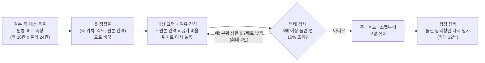

- **간격을 옮기는 이유**: 원본에서 몸과 떨어져 있던 거리를 그대로 옮기므로, 셔츠 위 겉옷처럼 겹친 층의 순서가 뒤집히지 않습니다(대응이 단조 증가).
- **형태가 먼저**: 몸 길이에 딱 맞추다 옷이 한쪽으로 크게 눌리면, 길이를 남기는 쪽으로 물러납니다. 소매는 손목 너머 손 길이, 아랫단은 허벅지 절반까지만 늘입니다.
- **모양으로 부품 구분**: 후드 끈은 이름이 아니라 "길이/굵기 3 이상, 몸 반지름의 35% 이하" 같은 모양으로 찾아 통째로 옮깁니다.

<details>
<summary>자세히: 원통 표와 간격 옮기기 · 측정 표 · 여유 간격 기준</summary>

**표면 간격 보존** (상의): 몸통(Hips -> Neck)·위팔·아래팔·허벅지를 축 하나의 원통으로 보고, 몸 정점을 (축 방향 위치 16칸 x 둘레 각도 24칸) 칸마다 가장 바깥 반지름으로 담은 표를 두 아바타에 각각 만듭니다. 가슴 흔들림 본처럼 Humanoid 아래에 달린 몸 본의 정점도 넣고(브라 컵이 옷을 뚫던 원인), 귀·꼬리·털 사슬은 뺍니다. 정점이 안쪽에만 잡혀 움푹 꺼진 칸은 이웃 평균으로 메우되 볼록한 칸(가슴)은 깎지 않습니다(평균으로 고르게 하면 옷이 가슴 안으로 들어감). 옷 정점은 원본 자세에서 (위치, 각도, 축 거리)로 바꾸고, 축 거리를 `대상 표면 + 여유 간격 + 원본 간격 x 굵기 비율`로 옮깁니다(몸 안쪽 정점은 같은 비율로 줄임). 여유 간격은 대상 몸통 원통 반지름(칸 중앙값)의 3.35%입니다(Lumelana 2.7mm로 엉덩이 높이 기준과 같고, 다리가 짧은 inuinu는 엉덩이 기준 0.87mm -> 4.0mm). 이 대응은 단조 증가라 안쪽 층이 바깥 층을 넘지 않습니다. 마디 경계는 정점의 스킨 가중치로 부위 결과를 섞고, 범위 밖 본(머리·손) 가중치만큼은 본 배치 위치를 유지한 뒤 그 정점만 관통 밀어내기를 합니다. 마지막으로 대상 몸의 변이 실제로 뚫고 지나간 옷 삼각형만 찾아 그 정점을 바깥 법선으로 몸통 원통 반지름의 3.7%(Lumelana 3mm, inuinu 4.5mm)씩 밀고, 뚫림이 늘지 않는 동안 최대 12번 반복해 가장 적었던 결과를 남깁니다. 미는 거리는 정점 묶음마다 쌓아 두고, 한 번 밀 때마다 "이웃 평균이 자기 값보다 크면 평균으로 올림"을 3번 해 뚫린 자리가 가시처럼 솟지 않고 완만한 언덕으로 올라오게 합니다(깎지는 않아 이미 몸 밖으로 나온 곳은 다시 들어가지 않음). 정점-평면 판정만으로는 정점 사이 넓은 면을 볼록한 속옷 컵이 뚫는 경우를 놓치기 때문입니다. 미는 방향은 옷 법선이지만, 몸 표면 안쪽에 있는 정점은 옷 법선이 가장 가까운 몸 표면의 바깥 법선과 60도 넘게 어긋나면 몸 바깥 법선으로 바꾸고, 몸 안쪽을 향한 뒷면 법선은 뒤집습니다(몸 점이 누적 밀기 한도보다 멀면 그대로).

| 측정 (フェリス 후드티 -> 대상, 원본 자기 교차 1,049) | 보정 끔 | 관통 밀어내기 | 간격 보존 정사이즈 | 간격 보존 오버핏 |
|---|---|---|---|---|
| Lumelana 후드티 자기 교차 삼각형 | 1,377 | 1,568 | 1,128 | 1,128 |
| Lumelana 몸·속옷이 뚫은 후드티 삼각형 | 337 | 293 | 86 (모두 후드) | 86 |
| inuinu 후드티 자기 교차 삼각형 | 1,210 | 1,263 | 1,162 | 1,162 |
| inuinu 몸이 뚫은 후드티 삼각형 | 560 | 558 | 272 | 272 |
| inuinu 2배 이상 눌린 후드티 삼각형 | 35.7% | - | 39.2% | 39.2% |

자기 교차는 후드티 삼각형을 후드티 자신의 변이 뚫은 수(옷이 접혀 겹친 정도)입니다. Lumelana는 원본 대비 +7.5%((1,128-1,049)/1,049)입니다. 눌림은 삼각형마다 원본에서 결과로 가는 변형이 한쪽 방향으로 몇 배 눌렸는지(두 늘음 비율의 비)로, 옷 디자인 비율이 지켜지는지 보는 지표입니다.

**여유 간격 기준**: 표면 간격 보존을 쓸 때 옷의 관통 밀어내기 여유 간격과 최대 거리는 엉덩이 높이 대신 몸통 굵기 기준(반지름의 3.35%·44%, Lumelana 값은 같음)입니다. inuinu 최대 거리가 11.6 -> 약 52mm가 되어 관통 274 -> 275, 자기 교차 1,166 -> 1,250이고 등판 작은 틈이 사라졌습니다. 몸 표면 격자 칸까지 몸통 기준으로 바꾸면 inuinu 관통이 310으로 늘어 그대로 둡니다.

</details>

<details>
<summary>자세히: 맞춤 방식 · 형태 검사 · 끈 · 소맷부리 · 후드 · 옆선/아랫단/앞섶 문제 해결</summary>

**맞춤 방식 (정사이즈·오버핏)**: 몸통·팔이 짧고 굵은 치비(inuinu 몸통 길이 x0.40, 굵기 x1.45, 아래팔 길이 x0.25, 굵기 x1.18)에 옷을 몸 길이 그대로 맞추면 지퍼·끈·소매가 한쪽으로 크게 눌려 형태를 알아보기 어려워집니다(2배 이상 눌린 삼각형 46.6%). 부위마다 한쪽 눌림(굵기 배율 / 길이 배율)에 상한을 두고, 넘으면 옷 길이를 남깁니다. 몸통 상한은 오버핏(기본) 2배, 정사이즈 4배입니다. 몸통은 목 쪽을 고정한 채 아랫단을 길게 두고, 아랫단에 섞인 허벅지 부위 정점도 같은 만큼 내려 아랫단이 지그재그로 접히지 않게 합니다. 소매(위팔·아래팔)는 두 방식 모두 4배로, 어깨·팔꿈치를 고정한 채 손 쪽으로 늘이고(관절보다 몸 안쪽은 늘이지 않음) 아래팔은 위팔이 늘어난 만큼, 소맷부리를 다는 손 본에 걸린 정점은 소매 끝이 늘어난 만큼 함께 옮깁니다(손목 장식·장갑, 아래팔 소매가 다시 배치되지 않는 경우는 옮기지 않음). 오버핏 소매 상한을 2·3배로 두면 소맷부리(원래 inuinu 아래팔의 약 2배 길이)까지 더해져 소매가 날개처럼 뻗어 쓰지 않았습니다. 또 소맷부리 본은 손 본 아래에 매달려 몸 비율(x0.22)로 소매(x0.73)보다 작게 오그라들었는데, 아래팔 굵기 배율(x1.18)로 균등하게 맞춰 소매가 발을 덮는 긴 소매가 되게 했습니다(손가락까지 덮는 장갑, 대상에 손가락이 없어 대체 연결된 손 본은 제외). 소매 길이 자체를 늘리거나 소맷부리를 아래팔 표면에 붙이는 방법은 소매가 날개·나팔처럼 뻗어 쓰지 않았습니다. 길이 배율이 충분한 Lumelana는 두 방식 결과가 같습니다(소맷부리만 소매 끝과 한 고리로 이어짐).

**형태 검사와 자동 후퇴** (최우선 원칙: 어떤 아바타·의상이든 형태가 무너지지 않아야 함): 맞춤 방식의 상한만으로는 inuinu 정사이즈 몸통(눌림 3.6배)처럼 상한 안인데도 형태가 무너지는 경우가 남았습니다. 배치한 뒤 삼각형마다 원본에서 결과로 가는 한쪽 눌림을 재서, 부위별로 3배 이상 눌린 면이 15%를 넘으면 그 부위의 상한을 0.7배씩(하한 1.4) 낮춰 다시 배치합니다(최대 4번). 기준값은 실모델 측정으로 정했습니다: 형태가 괜찮은 Lumelana는 모든 부위가 10% 이하, 무너진 inuinu는 24~64%입니다. 상한을 낮추는 것만으로는 소매가 팔보다 지나치게 길어져 날개처럼 뻗었으므로(눌림은 50% -> 4%로 좋아졌지만 모습은 무너짐), 늘일 수 있는 길이에 몸 기준 한도를 둡니다: 소매 끝은 손목 너머 손 길이(손목 -> 가운데 손가락 첫 마디의 2배, 손가락 본이 없으면 아래팔의 0.4배)까지, 아랫단은 엉덩이 아래 허벅지 절반까지입니다. 상한을 낮춰도 실제 늘임이 커지지 않는 부위(한도에 막혔거나 한쪽으로 눌리지 않은 부위)는 낮추지 않고, 부위가 섞이거나 일부만 옮긴 면은 비율에서 뺍니다. 낮춘 상한은 결과 보고에 "형태 보존" 줄로 남습니다. inuinu는 정사이즈도 몸통 상한 4 -> 2, 위팔 4 -> 2로 내려가 엉덩이에서 끝나는 후드티가 되고, 두 방식이 같은 한도에 닿아 결과가 같아집니다. Lumelana는 무너진 부위가 없어 그대로입니다.

**끈 모양 유지**: 후드 끈처럼 가늘고 길게 매달린 부품은 몸 부위 규칙(굵기·길이를 따로 맞춤)을 따르면 한쪽으로 눌려 옆에서 볼 때 가시처럼 앞으로 뻗었습니다(inuinu 끈 눌림 중앙값 2.02). 이름이 아닌 구조와 모양으로 끈을 찾습니다: Humanoid 본 바로 아래 옷 본의 자식 사슬을 묶어, 길이 / 굵기가 3 이상이고 굵기가 따르는 몸 부위 반지름의 35% 이하면 끈입니다(Felis 후드티 끈 굵기 19mm·길쭉함 12.3, 소맷부리 고리 56mm·1.7). 굵기 조건은 길쭉한 치마·옷자락 판자 가닥을 끈으로 오판하지 않게 합니다(실제 치마 의상은 미검증). 끈은 매달린 지점만 부위 규칙으로 옮기고, 나머지는 원본 모양 그대로 부위의 길이 배율(늘임 포함)과 굵기 배율의 기하평균만큼 균등하게 줄이거나 키웁니다. inuinu 끈 눌림 중앙값 2.02 -> 1.00(크기 x0.88), Lumelana 끈 1.19 -> 1.00(크기 x0.95)이 되었고, 결과 보고에 "끈 모양 유지" 줄이 남습니다. 통째로 둔 끈은 뒤따르는 겹침 정리·관통 보정이 정점마다 밀지 않게 고정하고(밀면 오른쪽 끈이 5배 눌려 구겨졌음), 몸 안으로 들어가면 매달린 지점을 중심으로 몸 바깥쪽으로 필요한 만큼만 통째로 돌립니다(3도씩 최대 60도).

**소맷부리 맞춤**: 소매 끝(손 본에만 묶인 Sleeve 본 사슬)은 손 본을 따라 원본 크기 그대로 손목 너머에 남아, inuinu 소매 끝이 팔 길이(위팔+아래팔+손)의 2.25배였습니다(원본 Felis 1.21배, Lumelana 1.34배). 손 본에만 묶인 덩어리를 팔 방향으로는 아래팔 길이·굵기 배율의 기하평균, 둘레로는 대상 손을 덮는 배율(손·손가락 몸 정점이 아래팔 축에서 떨어진 거리 90% 분위수의 비, 팔 방향 배율의 1~2배)로 맞추고, 원본·대상 팔 각도 차이만큼 돌려 아래팔 소매 이음매(축별 중앙값)에 붙입니다. 장갑(손가락 본이 있는 손 본)은 빼고, 원래 자리에서 팔 길이보다 멀리 옮겨지면 그대로 둡니다. 소매 끝은 inuinu 팔의 2.25 -> 1.81배, Lumelana 1.34 -> 1.23배(원본 1.21배)가 되었습니다. 둘레까지 아래팔 배율로 줄였을 때는 inuinu의 굵은 앞발이 소매를 뚫어(관통 259 -> 305) 둘레는 손에 맞췄고, inuinu 관통은 272개입니다.

**길이 방향 한 줄 꺼짐과 옆선 톱니**: 뒤에서 본 inuinu 가슴 몸판 옆선 톱니(부위별 색 캡처로 확인)는, 둥근 등과 옆이 만나는 대각선 방향(127도)에 몸 정점이 성겨 원통 표 반지름이 줄마다 163mm와 192mm를 오간 탓이었습니다. 위아래 두 줄보다 낮은 칸만 두 줄 평균으로 올려(허리처럼 여러 줄에 걸친 오목함·볼록한 칸은 그대로) 175~192mm가 되었고, 옆선이 매끈해졌습니다(자기 교차 1,239 -> 1,182, 관통 245 -> 259).

**후드 덩어리째 붙이기**: 머리·목 본에만 묶인 후드는 머리 본을 따라 이미 머리 크기 비율로 균등하게 커져 모양이 지켜지지만(inuinu 눌림 중앙값 1.01, 크기 x1.68), 몸통 규칙으로 놓인 목둘레와 따로 움직여 뒤 후드 아래에 틈이 생겼습니다. 머리·목 정점을 삼각형으로 이어진 덩어리로 나누고, 덩어리마다 목둘레 이음매(몸통 규칙으로 놓인 정점과 이어진 변)의 벌어짐 축별 중앙값만큼 모양 그대로 옮깁니다(쌍 3개 미만이면 옮기지 않고, 몸통 반지름의 절반까지). inuinu 후드는 28mm(뒤·아래), Lumelana는 3mm 옮겨졌고 inuinu 몸 관통은 257 -> 245개입니다. 결과 보고에 "후드 붙이기" 줄이 남습니다.

몸판·소매까지 통째로(길이와 둘레를 같은 배율로, 늘임 한도 없이) 맞추는 실험도 했습니다. inuinu 2배 이상 눌린 면 39.2% -> 10.9%, 관통 257 -> 199로 수치는 크게 좋아졌지만, 소매가 팔의 약 3배로 뻗고 옷자락이 다리를 덮어 "너무 큰 옷을 입은" 모습이 되어 채택하지 않았습니다(길이 0.3~0.5배와 둘레 1.5~2배를 균등 배율 하나로 동시에 맞출 수 없음).

**허벅지 깊이 섞기와 뒤 아랫단 톱니**: inuinu 뒤 아랫단이 톱니처럼 들쭉날쭉하던 원인은 Hips·허벅지 가중치가 섞인 아랫단 정점이 두 규칙을 오간 것이었습니다. 같은 원본 점을 몸통 규칙과 허벅지 규칙으로 옮기면 131~164mm(몸통 반지름 대비 중앙값 inuinu 0.30, Lumelana 0.52) 벌어지고, 이웃 정점마다 두 가중치 비율이 달라 결과가 두 위치 사이를 오갔습니다(겹침 정리·꼬리 구멍을 꺼도 그대로라 배치 단계 문제로 확인). 이제 허벅지 가중치 점은 원본 허벅지 축 깊이(엉덩이 0 ~ 무릎 1)가 0.3까지면 몸통 규칙, 0.7부터 허벅지 규칙, 그 사이는 깊이에 따라 부드럽게 섞습니다. 위치로만 정하므로 이웃 정점이 같은 비율을 받고, 바지 다리처럼 허벅지 깊은 곳은 허벅지를 그대로 따릅니다. 정점별로 엉덩이 안쪽일 때만 바꾸는 방법과 아바타별 허벅지 묻힘 비율로 고르는 방법(inuinu 100%, Lumelana 97%라 구분 못 함)은 시도 뒤 버렸습니다. 아랫단 허벅지 정점의 이웃 대비 튐이 3mm 넘게 커진 Hips 정점은 157 -> 117개, inuinu 2배 이상 눌린 면 40.3% -> 39.2%, Lumelana 11.4% -> 10.1%이고, Lumelana 아랫단은 조금 길고 곧게 바뀌었습니다.

**빈 칸 메우기와 앞섶 가시**: 옆에서 본 inuinu 앞섶이 가시처럼 앞으로 뻗던 원인은 대상 몸통 원통 표였습니다. 저폴리 몸은 배 앞 높이 한 줄에 정점이 뒤쪽 5칸에만 잡혀, 빈 앞 칸이 같은 줄 둘레로 가장 가까운 뒤 대각선 칸 값(192mm)으로 채워졌습니다(실제 배 앞 84mm). 그래서 원본에서 몸과 8mm 떨어진 앞판이 118mm 앞으로 밀려났습니다. 이제 빈 칸은 같은 줄 이웃(호 길이)과 같은 각도의 위·아래 줄(줄 간격, 양쪽이면 보간) 중 실제 표면 거리가 가까운 쪽으로 채웁니다. 가장 앞으로 튀어나온 곳이 앞섶 118mm에서 끈 끝 66mm로 줄었고, 앞판이 배를 따라 붙습니다. 몸통이 실제 크기로 줄어 inuinu 2배 이상 눌린 면은 35.7% -> 40.3%, 몸 관통은 246 -> 256으로 늘었습니다. Lumelana는 11.1% -> 11.6%, 관통 86 그대로입니다.

</details>

### 관통 밀어내기 (기본 보정)

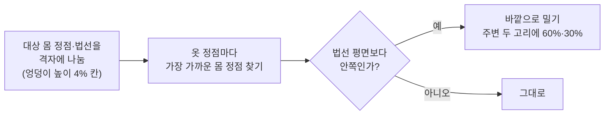

<details>
<summary>자세히: 관통 밀어내기</summary>

**관통 밀어내기**: 대상 몸 정점(Humanoid 본에 묶인 정점)과 바깥 법선을 격자(엉덩이 높이의 4% 칸)로 나눕니다. 맞춘 의상 정점을 현재 본 위치로 펼쳐 주변 칸에서 가장 가까운 몸 정점을 찾고, 그 법선 평면 기준 여유 간격(엉덩이 높이의 0.6%)보다 안쪽이면 바깥으로 밉니다. 밀 거리가 엉덩이 높이의 8%를 넘으면 법선을 잘못 짚은 것으로 보고 밀지 않습니다. 몇 정점만 튀어나오면 옷이 찢어져 보이므로 주변 두 고리의 정점에 이동량을 60%, 30% 나눠 줍니다. UV 이음새처럼 같은 위치에 겹친 정점은 하나로 묶어 같이 밀어 옷이 이음새를 따라 갈라지지 않게 합니다. 몸과 옷 정점 모두 Unity와 같은 4본 섞음 스키닝으로 펼치고, 이동량은 그 행렬의 역행렬로 메시 공간에 되돌립니다. 꺼져 있는 메시(벗겨 둔 옷)는 몸 표면으로 치지 않습니다.

</details>

### 치비용 풀어 주기 · 늘어뜨리기

| 단계 | 하는 일 | inuinu 결과 |
|---|---|---|
| 풀어 주기 (10단계) | 몸통은 지금 변 길이를 지키며 접힘만 펴고, 소매는 원본 소매 모양을 팔 비율로 바꾼 길이로 당김 | 몸 관통 272 -> 185, 소매가 앞발을 덮는 매끈한 통 |
| 늘어뜨리기 (60단계) | 몸통 위쪽만 고정하고 아래쪽을 중력처럼 흘러내리게 함(몸통 한쪽 눌림 2 이상일 때만) | 옆구리에 겹친 천이 세로로 펴짐, 아랫단 52mm 길어짐 |

<details>
<summary>자세히: 풀어 주기 · 늘어뜨리기</summary>

**풀어 주기 옵션 (치비용, 기본 끔)**: 창의 "풀어 주기"를 켜면, 겹침 정리까지 마친 뒤 몸통·소매를 10단계 짧게 풀어(위치 기반 반복, Pixar 리핏처럼 지금 위치에 붙인 채) 길이로 크게 눌린 곳의 날카로운 접힘을 펴고, 아랫단은 엉덩이까지만 늘입니다. 몸통은 지금 변 길이를 지키며 접힘만 반쯤 펴고 단단히 붙이고(0.15), 소매는 원본 소매 모양을 팔 마디 비율(축 방향 길이·둘레 굵기)로 바꾼 쉼 거리로 당겨 매끈한 통으로 만듭니다(붙임 0.03). 몸 충돌은 부위 원통 표와 몸 표면 가장 가까운 점으로 막고, 끈·후드는 고정합니다. inuinu(정사이즈·오버핏 같음): 몸 관통 272 -> 185, 기장이 엉덩이에서 끝나는 짧은 후드티, 소매는 앞발을 덮는 매끈한 통, 뒤 아랫단 톱니 사라짐. 2배 이상 눌린 면은 39.2% -> 63.9%로 오르는데, 기장을 줄인 만큼 천이 눌리고 소매의 극단적 눌림(4배 이상)이 고르게 퍼지기 때문입니다. Lumelana는 관통 86 그대로, 눌림 10.9% -> 18.5%. 옵션을 끄면 이전과 같습니다. 시간은 두 아바타 합 +1.9초(784 -> 2,710ms, CPU 부하 65%). 바꾼 순서가 중요했습니다: 풀어 주기를 겹침 정리 앞에 두면 뒤따르는 정점별 밀기가 편 접힘을 다시 세웠고(관통 301), 소매 쉼 모양을 정점 절대 위치에 마디 변환을 걸어 만들면 팔꿈치·어깨 변이 어긋나 소매가 가늘게 끊어졌습니다(변 벡터에 걸어 해결). 아랫단 한도는 같은 대상의 모든 의상에 적용되므로 원피스·롱코트도 엉덩이까지가 됩니다.

**늘어뜨리기 (풀어 주기의 마지막 단계)**: 풀어 주기 뒤에도 inuinu 옆구리에는 남는 천(몸통 길이 약 0.4배)이 가로로 겹쳐 안감이 층처럼 드러났습니다. 접힘만 더 펴거나(변화 없음) 옆구리·몸통을 원본 비율 쉼 거리로 당기면(앞판이 찢어지거나 줄무늬가 더 또렷해짐, 관통 231~287) 해결되지 않아, 천 시뮬레이션처럼 중력으로 늘어뜨립니다. 몸통 위쪽(엉덩이~목 높이 75% 위)만 고정하고 아래쪽을 60단계 위치 기반 반복(변 길이 유지, 접힘 반쯤 펴기, 몸통·허벅지 원통과 몸 표면 밖 유지, 천끼리 겹침 방지, 정점별 이동 상한)으로 흘러내리게 하면 층이 세로로 매끈하게 펴집니다. 고정점과 이어지지 않은 조각(단추 등)은 움직이지 않습니다. 남는 천이 아래로 빠지므로 아랫단이 52mm 길어집니다(엉덩이 아래 약 10cm). 몸통이 원본에 가까운 아바타는 겹칠 천이 없고 늘어뜨리면 앞판 아래가 벌어져, 늘인 뒤 몸통 한쪽 눌림이 2 이상일 때만 합니다(실측 inuinu 2.89, Lumelana 1.06이라 Lumelana는 하지 않음). inuinu 몸 관통 185 -> 196, 두 아바타 합 풀어 주기 포함 1,911ms(CPU 부하 32%).

</details>

### 모자 · 꼬리 · 털

| 부위 | 찾는 방법 | 처리 |
|---|---|---|
| 모자 | 정수리를 덮는 본 없는 머리 소품 | 머리 정점 격자로 두상에 맞춰 밀고, 귀 변이 지나가는 모자 삼각형을 지움 |
| 꼬리 | Hips 아래 tail·しっぽ 등 이름 본(Ponytail 제외) | 꼬리 표면까지 거리 0인 선으로 옷을 잘라 냄(안 되면 지우고 가장자리를 꼬리에 붙임) |
| 털 | fur·fluff·もふ 등 이름 본 묶음 | 뿌리가 옷 안쪽이면 그 털 묶음 삼각형을 숨긴 새 메시로 교체 |

<details>
<summary>자세히: 털 숨김 · 꼬리 구멍 · 경계선 자르기 · 가장자리 붙이기 · 모자 두상 맞춤</summary>

**털 숨김**: 수인·퍼리 아바타의 메시 털(본마다 따로 붙은 털 묶음, 예: Lumelana의 FurChest·FurLowerArm)은 Humanoid 본이 아니라 몸 표면 측정에서 빠져 옷을 그대로 뚫습니다. 털 이름 본(fur·fluff·もふ, Further·FluffyHair 등 제외) 묶음마다 정점이 묶인 가장 위쪽 털 본을 뿌리로 보고, 뿌리가 새 옷 안쪽(가장 가까운 옷 정점의 법선 평면 뒤, 엉덩이 높이의 8%와 몸통 반지름의 60% 중 큰 거리 이내)이면 그 묶음의 삼각형을 대상 아바타 메시에서 지운 새 메시로 바꿉니다(원본 메시는 그대로, Ctrl+Z로 되돌림). 몸통 기준 거리는 표면 간격 보존으로 옷이 원본처럼 가슴에서 떨어져 놓일 때 가슴 털이 거리 한도에 걸려 옷을 뚫던 문제(Lumelana 가슴 털 뿌리와 옷 38mm, 엉덩이 기준 한도 37mm)를 막습니다(숨긴 털 묶음 5 -> 6개). Modular Avatar의 Shape Changer(Delete)·Mesh Cutter(By Bone)가 "옷에 가려지는 본체 부분을 지우는" 것과 같은 방식입니다. 옷을 털 위로 부풀리면 털 길이만큼 옷이 뜨고, 털 본 크기를 0으로 줄이면 PhysBone이 깨질 수 있어 쓰지 않았습니다.

**꼬리 구멍**: 귀 구멍과 같은 선분-삼각형 교차로, 가장 가까운 Humanoid 조상이 Hips인 꼬리 이름 본(tail·tale·shippo·しっぽ·尻尾, 머리의 Ponytail 제외)에 묶인 꼬리 메시의 변이 통과하는 옷 삼각형을 지웁니다. 교차 검사는 꼬리 변을 격자 칸에 나눠 겹치는 칸만 봅니다(모든 쌍을 비교하면 의상 6개 맞추기가 8,016ms까지 늘었음).

**꼬리 둘레 경계선 자르기**: 삼각형을 통째로 지우면 구멍이 옷 메시 격자를 따라 계단처럼 각집니다(Lumelana 꼬리 위 톱니). 그래서 꼬리 구멍은 옷 정점마다 꼬리 표면까지의 부호 있는 거리(바깥 +, 안쪽 -, 안쪽 판정은 열린 메시에도 쓰는 일반화 와인딩 수)에서 관통 보정 여유 간격을 뺀 값을 재고, 이 값이 0인 선에서 삼각형을 잘라 냅니다. 새 정점의 위치·UV·법선·본 가중치·블렌드셰이프는 변 양 끝을 보간하고, 경계점은 변 위에서 실제 거리를 4번 다시 재서 맞춥니다(양 끝 값만으로 직선 보간하면 둥근 꼬리 둘레에서 6mm 안쪽에 놓였음). UV 이음선 양쪽은 같은 위치 정점 묶음 기준으로 한 번만 재서 틈이 생기지 않습니다. 자르는 곳은 꼬리 변이 실제로 뚫은 삼각형과 그 한 고리 이웃뿐이고, 잘라 낸 넓이가 기존 방식(뚫린 삼각형 삭제)의 2배를 넘거나 정점당 본 가중치가 4개를 넘는 메시는 기존 방식(삭제 + 아래 가장자리 붙이기)을 씁니다. inuinu는 옷이 짧은 꼬리를 덮고 삼각형이 커서 꼬리 근처 옷이 넓게 잘려 나가므로(제한 없이 270개, 한 고리 제한 235개) 기존 방식으로 처리됩니다. Lumelana 꼬리 위 계단 톱니가 사라졌고, 몸 관통 수는 두 아바타 모두 그대로입니다(Lumelana 86, inuinu 289, 풀어 주기 켬 208).

**꼬리 구멍 가장자리 붙이기**: 꼬리 구멍을 경계선 자르기로 내지 못하는 경우(위 조건)에는 삼각형을 지운 뒤 새로 생긴 구멍 가장자리 정점을 가장 가까운 꼬리 변에서 관통 보정 여유 간격만큼 떨어진 곳으로 당기고(이웃 2고리에 0.5·0.25 비율로 나눔), 가장자리 고리를 이웃 평균 쪽으로 3번 다듬어(매번 다시 꼬리에 붙임) 하나씩 튀어나온 정점을 펴고, 당긴 결과가 몸 안으로 들면 옮기지 않습니다. 당길 거리가 한도(엉덩이 높이의 8%)보다 멀면 한도까지만 당깁니다. 처음에는 아예 두었는데, 삼각형이 큰 inuinu는 가장자리 정점 81개 중 59개가 꼬리에서 12~36mm 떨어져(한도 11.6mm) 움직이지 않았고, 꼬리 왼쪽 틈으로 그늘진 엉덩이가 olive색 조각처럼 보였습니다. 한도까지 당기면 이 조각이 사라지고, inuinu 몸 관통은 289 -> 299(풀어 주기 켬 208 -> 204)입니다. 메시 격자를 따라 각지고 꼬리보다 넓던 구멍(Lumelana 꼬리 둘레에 살이 톱니처럼 보임)이 대부분 꼬리에 붙어 가려집니다. 꼬리 메시 변이 가까워진 가장자리 이웃 면을 지나 inuinu 몸 관통 수는 272 -> 289(다듬기 포함)로 늘었습니다(여유 간격을 2배로 해도 281이고 톱니가 더 보여 채택 안 함). 모자 귀 구멍은 귀 밑동에 이미 가려지고, 붙이면 귀 옆 모자 가장자리가 거칠어져 하지 않습니다.

| 측정 (フェリス 후드티 등 3개 -> Lumelana, inuinu) | Lumelana | inuinu |
|---|---|---|
| 옷에 가려져 숨긴 털 묶음 | 8개 중 5개 (삼각형 1,128개) | 털 메시 없음 |
| 꼬리 구멍으로 지운 후드티 삼각형 | 32개 (경계선 자르기 뒤 지우거나 잘라 낸 삼각형 48개) | 35개 |

**모자 두상 맞춤·귀 구멍**: 정수리를 덮는(위에서 볼 때 정수리를 가리고 윗면이 정수리 근처까지 닿는) 본 없는 머리 소품을 모자로 봅니다. 모자는 오브젝트 행렬로 펼쳐 같은 방식으로 밀되, 머리 정점만으로 만든 격자(엉덩이 높이의 4%와 머리 폭의 10% 중 큰 칸)를 쓰고 여유 간격과 상한을 머리 폭의 2%·15%로 둡니다. 치비는 엉덩이가 낮아 칸이 작은데 머리 정점은 성겨서 모자 정점 근처의 머리 정점을 못 찾기 때문입니다(옷 격자는 그대로 두어 옷 보정 결과는 바뀌지 않음). 귀는 머리 아래 Humanoid가 아닌 본 중 이름에 단어 ear(CatEar 같은 대소문자 경계 포함, Earring·Earphone·Year 제외)·mimi·耳가 들어간 본에 묶인 정점입니다. 세 정점이 모두 귀인 삼각형의 변이 모자 삼각형을 통과하면(Möller–Trumbore 선분-삼각형 교차) 그 삼각형을 지웁니다. 귀 정점 근처를 모두 지우는 방식은 귀 밑동 주변까지 지워 (실모델에서 모자 삼각형의 19%) 쓰지 않았습니다.

</details>

### 결과 보고

**결과 보고**: 대상마다 이름 규칙으로 귀·꼬리·털을 찾았는지("부위 찾기")와, 정리 뒤에도 몸이 뚫는 옷 삼각형의 부위별 개수("남은 겹침")를 남깁니다.

## 실제 모델 검증에서 찾은 문제

코드로 만든 테스트 아바타에서는 통과했지만 BOOTH 실모델에서 드러난 문제를 원인부터 확인해 고치고, 각각 재현 테스트를 추가했습니다.

| 증상 | 원인 | 수정 | 수정 전 -> 후 |
|---|---|---|---|
| 머리 비율이 최솟값 0.05로 잘림 | inuinu는 FBX 단위 때문에 Armature 스케일이 100인데, `BakeMesh`가 이를 반영하지 않은 좌표를 반환 | 본 행렬 x 바인드포즈로 정점 위치 직접 계산 | 머리 폭 0.0044m -> 0.436m |
| フェリス 파츠 정점이 구역 측정에서 빠짐 | 파츠마다 Armature가 따로 있는 구조(Modular Avatar 방식)라 파츠 정점이 메인 Humanoid 본 아래로 인식되지 않음 | 파츠 본을 같은 이름의 메인 본으로 대응 | 손 폭 0 -> 0.185m (손 구역을 지원하던 때 측정) |
| 안경 높이가 이마로 올라감 | 강아지 귀가 머리 상자를 위로 늘림 | Humanoid가 아닌 본의 정점을 구역에서 제외 | 상자 높이 0.455m -> 0.367m |
| フェリス 의상 파츠가 모두 "본 연결이 비어 있음" 오류 | Modular Avatar 방식 의상은 본 목록에 정점이 쓰지 않는 빈 칸이 섞여 있음 | 정점 가중치가 실제로 쓰는 본이 빌 때만 오류 | 파츠 5개 차단 -> 모두 실행 가능 |
| 일괄 적용에서 후드·귀·안경이 과하게 커짐 | 같이 옮길 의상을 원본 측정에서 모두 빼자 원본 머리 상자만 얼굴 크기로 줄어듦 | 머리 상자는 옮기는 의상만 빼고, 마디 굵기만 전체를 뺌 | 머리 비율 과대 -> 이전 크기로 복구 |
| 후드 위에 쓴 니트 모자가 대상에서 후드 안으로 들어감 | 의상마다 자기 자신만 빼고 머리를 재서, 후드티는 후드 없는 머리로, 모자는 후드 포함 머리로 비율을 냄 | 머리 상자는 원본을 입은 그대로 한 번 재서 모든 의상이 공유 | Lumelana 후드 x1.36·모자 x0.96 -> 둘 다 x0.96, inuinu x2.37·x1.68 -> 둘 다 x1.68 |
| 후드티가 아래로 수 미터 늘어남 | フェリス의 Hips와 Spine 본이 1mm 차이라 Hips 길이 비율이 20배로 폭주 | 짧은 마디는 길이 대신 몸 비율 사용 | Hips 길이 비율 20.00 -> 0.70 |
| 안경이 강아지 얼굴 안에 묻힘 | 상자 비율만으로는 볼·주둥이 굴곡을 반영하지 못함 | 얼굴 앞면과의 간격 유지 | 안경 아래 테가 볼에 가려짐 -> 두 렌즈 모두 보임 |
| TRIM 니트 모자가 "깨진 의상" 오류로 막힘 | 본 없이 블렌드쉐이프만 가진 SkinnedMeshRenderer를 본 누락으로 판정 | 본·바인드포즈가 없는 스킨 메시는 단단한 소품으로 처리 | 오류로 차단 -> 머리 본에 부착 |
| 후드티가 Lumelana에 작게 맞춰져 가슴·어깨 피부가 비침 | 굵기를 단면 평균 반지름으로 재 가슴이 0.79배로 작게 잡힘, 척추 본 위치 차이로 몸통 길이가 0.42배로 눌림 | 마디 가운데 구간 바깥 윤곽(90%)으로 굵기, Hips~Neck 거리로 몸통 길이 | 가슴 굵기 0.81 -> 0.97배, 몸통 길이 0.42 -> 0.92배, 몸 안쪽에 남은 후드티 정점 280 -> 257개 |

## 구조

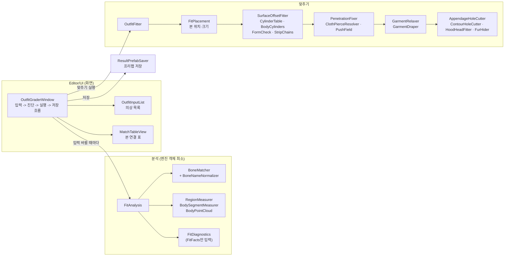

| 폴더 | 역할 | 주요 클래스 |
|---|---|---|
| `Assets/OutfitGrader/Editor/UI/` | 창 흐름, 의상 목록, 본 연결 표 | `OutfitGraderWindow`, `OutfitInputList`, `MatchTableView` |
| `Assets/OutfitGrader/Editor/Core/` (분석) | 본 매칭, 크기 측정, 진단 | `FitAnalysis`, `BoneMatcher`, `BoneNameNormalizer`, `AvatarRig`, `RegionMeasurer`, `BodySegmentMeasurer`, `ScaleProfile`, `FitDiagnostics` |
| `Assets/OutfitGrader/Editor/Core/` (맞추기) | 본 배치, 표면 간격 보존, 관통 보정, 풀어 주기, 구멍·털 처리, 저장 | `OutfitFitter`, `FitPlacement`, `SurfaceOffsetFitter`, `CylinderTable`, `BodyCylinders`, `ClothPierceResolver`, `PushField`, `EdgeGrid`, `GarmentRelaxer`, `GarmentDraper`, `ResultPrefabSaver` |
| `Assets/OutfitGrader/Tests/Editor/` | EditMode 테스트 211개, 코드로 만든 Humanoid 아바타(`TestRigBuilder`) 사용 | |

- 이름 정규화, 위치 계산, 축 판정, 진단 규칙은 엔진 객체 없이 테스트할 수 있는 순수 함수입니다.
- 진단 규칙은 `FitFacts`(사실 모음)만 입력으로 받아 단독으로 검증합니다.

<details>
<summary>성능 측정 기록 (맞추기 시간 변화와 최적화)</summary>

- 몸 정점은 `BodyPointCloud`로 아바타마다 한 번만 읽고 머리·마디 측정이 공유합니다. 의상 6개 분석(범위 축소 전 시연 세트, 두 아바타 정점 93,368개) 중앙값 734ms -> 395ms(46.2% 감소 = (734-395)/734, 5회 측정). 손 구역·다리 마디 측정을 뺀 범위 축소로 410ms -> 348ms(15.1% 감소)까지 줄었다가, 머리 상자를 착용 상태 그대로 재는 규칙으로 바꾼 뒤 389ms, 마디 굵기를 바깥 윤곽(거리 정렬)으로 잰 뒤 395ms가 되었습니다.
- 관통 밀어내기는 같은 의상 6개 기준 맞추기 시간을 4~15ms에서 중앙값 240ms로 늘립니다(3회 측정). 모자용 머리 격자·귀 구멍(96 -> 154ms), 털 숨김·꼬리 구멍(154 -> 240ms)이 차례로 더해졌습니다.
- 표면 간격 보존을 켜면(오버핏) 중앙값 515ms(9회, 486~532ms), 같은 실행에서 끈 경우 201ms의 2.6배입니다(형태 검사·재배치 포함, CPU 부하 15%에서 측정). 앞섶 가시 수정 뒤에는 CPU 부하 81%에서만 재서 간격 보존 822ms, 관통 보정만 324ms(같은 실행 2.5배, 3회 중앙값)였습니다. 매끄럽게 밀기로 다시 판정할 삼각형이 늘어 843ms까지 늘었다가, 변 교차 격자에서 변마다 범위를 미리 계산하고 한 판정 안에서 같은 변을 두 번 검사하지 않게 하고(결과 동일 확인), 한 번 미는 거리의 1%보다 작은 변화는 반영하지 않아 525ms가 되었습니다(37.7% 감소 = (843-525)/843). 첫 구현은 2,840ms였고, 겹침 정리가 매번 모든 삼각형을 다시 판정하던 것을 움직인 정점이 닿은 삼각형만 다시 판정하도록(결과 동일) 바꾸고, 원본 몸 원통을 의상마다 만들지 않고 나눠 쓰고, 몸 메시의 공유 변을 한 번만 담아 701ms가 되었습니다(75.3% 감소 = (2,840-701)/2,840). 첫 측정은 다른 의상 목록 없이 분석해 원통 공유가 적용되지 않은 입력이었고, 이후 창과 같은 입력으로 측정했습니다.
- 꼬리 둘레 경계선 자르기는 기본 설정(표면 간격 보존) 맞추기를 같은 실행 기준 839ms -> 1,297ms(54.6% 증가 = (1,297-839)/839, 3회 중앙값)로 늘립니다. 관통 보정만은 514 -> 828ms입니다. 꼬리 메시(Lumelana 삼각형 4,414개)와의 거리·와인딩 수 계산 때문이며, 후보 정점 제한·삼각형 상자 건너뛰기·넓이 판정 먼저 하기로 첫 구현(관통 보정만 약 1,950ms)에서 줄였습니다. 풀어 주기를 켠 측정은 2,127 -> 1,362ms로 줄었는데, 원인은 확인하지 않았습니다.
- 이후 꼬리 경계선의 거리는 자를 영역 근처 꼬리 삼각형만 보고, 안팎은 가장 가까운 꼬리 면 뒤쪽으로 나온 점만 와인딩 수로 확인하며, 구멍 가장자리 다듬기는 정점마다 처음 붙인 자리 주변 변만 다시 찾아 기본 설정 맞추기가 약 1,358 -> 1,000ms(26% 감소 = (1,358-1,000)/1,358, 3회 중앙값)가 되었습니다(관통 수·구멍 모양 같음). 이후 준비 단계 스키닝 1회 공유, 꼬리 변·면 최근접 격자 탐색, 몸 조상 본 캐시, 겹침 정리 언덕 고르기 범위 축소 등으로 약 530ms(3회 중앙값, 1,358ms에서 61% 감소 = (1,358-530)/1,358)가 되어 목표 700ms 기준을 만족합니다. 모든 단계에서 관통·자기 교차·구멍 결과가 같음을 확인했습니다.

</details>

## 테스트 실행

Unity Test Runner(EditMode)에서 실행하거나 명령줄로 실행합니다.

```powershell
& "C:\Program Files\Unity\Hub\Editor\2022.3.62f3\Editor\Unity.exe" -batchmode -projectPath . -runTests -testPlatform EditMode -testResults results.xml
```

## 알려진 한계

- Modular Avatar는 업로드할 때 의상 본을 합쳐 의상이 오브젝트 하나로 남지만, 이 도구는 MA 없이 동작하도록 의상 본을 대상 본 아래로 직접 옮깁니다. 의상을 빼려면 Ctrl+Z를 쓰거나 옮겨진 오브젝트(`<본>_<의상>`)를 함께 지워야 합니다.
- 창에서 직접 지정한 본 연결은 스크립트를 다시 컴파일하면 초기화됩니다(안내 문구 없음).
- 얼굴 앞면 간격 보정은 머리 상자 앞쪽 절반의 소품에만 적용합니다. 뒤통수 소품은 상자 상대 위치만 씁니다(실모델 미검증).
- 배율 슬라이더를 움직일 때마다 아바타 메시 정점을 다시 읽습니다. 정점 수가 많은 아바타에서의 응답 시간은 재지 않았습니다.
- 창 화면은 자동 테스트가 없고 수동 확인 대상입니다.
- 축마다 다른 배율을 받은 의상 본에 직접 묶인 메시 정점은 본이 회전하면 약간 비틀릴 수 있습니다(따라가는 자식 본은 보조 오브젝트로 막지만, 해당 본 자체 정점은 그대로).
- 원본이 A 자세이고 대상이 T 자세인 경우의 길이 축 판정은 순수 함수 단위로만 검증했고 실모델로는 확인하지 않았습니다.
- 표면 간격 보존을 끄면 몸 굵기를 마디 단면 하나로 맞추므로 가슴처럼 앞뒤 모양이 다른 부위에서 옷이 들뜨거나 몸이 비칠 수 있습니다. 관통은 밀어내기로 줄이지만, 엉덩이 높이의 8%보다 깊은 관통은 안전을 위해 그대로 둡니다.
- 표면 간격 보존은 상의 몸통·팔만 다룹니다. 후드는 본 배치·관통 밀어내기 뒤 두상 맞춤으로 머리·목 부분을 모양 그대로 머리에서 최대 머리 폭 2%까지 떼어 냅니다(머리·목 피부 관통이 줄고 몸 관통이 늘지 않을 때만, 이음매 묶음 단위로 이웃 두 고리에 나눔). inuinu 몸 관통 275 -> 237, 머리·목 피부가 뚫는 후드 삼각형 129 -> 82입니다(3%로 떼면 228이지만 허리 위 등판 이음 부분에 목 피부가 작은 점으로 드러남). Lumelana는 머리카락 메시가 후드를 지나는 것뿐이라 그대로입니다(뒤에서 머리카락에 가려짐). 5% 이상 떼면 목·뒤통수가 띠처럼 드러나고, 정점마다 머리 표면으로 밀면 수가 줄지 않아 쓰지 않습니다.
- inuinu 정면에서 엉덩이 앞 몸 볼록(kosi 본)이 열린 앞판 가장자리를 뚫어 보입니다. 남은 관통 국소 정리, 이웃 함께 옮기기, 남은 관통 정점 다시 밀기 모두 효과가 없거나 나빠져 한계로 둡니다.
- 풀어 주기 옵션의 늘어뜨리기는 남는 천을 아래로 보내므로 inuinu 아랫단이 엉덩이 아래 약 10cm까지 내려옵니다. 짧게 되돌리려고 내려온 몸통 삼각형을 지우면(자른 선이 메시 격자를 따라 들쭉날쭉하고 아랫단 밴드가 사라져 누더기처럼 보임, 겉면 뒤 천이 남아 짧아지지도 않음) 정점을 엉덩이 높이로 끌어올리면(남는 천이 한 높이에 납작하게 몰려 치마 챙처럼 퍼짐, 자기 교차 1,366 -> 1,427) 모두 더 나빠 넣지 않았습니다. 짧은 기장과 매끈한 옆구리를 함께 얻으려면 접는 선 기준으로 천을 안으로 접어 넣는 처리가 필요합니다.
- inuinu처럼 머리가 몸보다 큰 치비 저폴리 아바타는 형태 검사로 엉덩이에서 끝나는 후드티가 되지만, 소매는 여전히 팔의 1.81배라 손끝 너머로 뻗고, 소맷부리는 손을 덮도록 둘레를 키워 넓은 통 모양이 됩니다(몸이 뚫은 후드티 삼각형 272개). 아래팔 소매는 길이 방향으로 5배 가까이 눌려 주름이 톱니처럼 서는데, 주름 높이를 줄이면 소매가 팔에 붙어 앞발이 뚫고 나와(관통 245 -> 308) 채택하지 않았습니다. 형태 검사는 허벅지 주 본 삼각형을 몸통 비율에 넣지 않아, 몸통 규칙으로 놓인 아랫단 일부가 눌려도 몸통 상한이 낮아지지 않을 수 있습니다. 바지 같은 하의는 지원 범위가 아니라 실모델로 확인하지 않았습니다. 끈 매달린 지점 쪽(String_001, 부위 규칙)은 눌림 약 2.1배가 남고, 고정한 끈은 회전으로도 몸 밖에 못 나오면 몸 안에 남을 수 있습니다. 길이 방향 빈 칸 채움이 팔·허벅지처럼 짧은 부위의 반지름에 주는 영향은 따로 재지 않았습니다. 끈은 원본 길이 비율대로 남아 짧은 치비에서는 발 근처까지 내려옵니다. 형태 검사는 "한쪽 눌림"만 재므로, 눌리지 않고 다른 방식으로 무너지는 형태(지나친 길이 등)는 늘임 한도로만 막습니다. 겨드랑이처럼 몸통과 팔 가중치가 섞인 곳은 몸통 쪽만 늘어나 이음매가 조금 늘어날 수 있습니다. 눌림 상한은 굵기 배율 / 길이 배율로 판정하므로, 키는 같고 몸통만 아주 굵은 아바타(굵기 2배 이상)는 오버핏에서 아랫단이 길어질 수 있습니다(실모델 미검증). 소맷부리 규칙은 간격 보존을 끈 경우에도 적용되어 inuinu 보정 끔·밀어내기 결과도 바뀌었습니다(관통 530 -> 560, 580 -> 558). 미는 거리만 키우면(이웃 4고리로 넓게 나눠도) 옷 가장자리가 가시처럼 삐죽해져, 이동량을 이웃 평균으로 올리는 매끄럽게 밀기와 함께 씁니다. 자기 교차는 1,317 -> 1,471개로 늘었지만 앞·옆·뒤 캡처에서 보이는 문제는 찾지 못했습니다. 소매·소맷부리는 원인 확인이 더 필요합니다.
- 원통 끝 줄은 마디 범위 밖 정점(골반 등)까지 모아 "마디 너머 몸"으로 씁니다. 그래서 대상이 원래 치마·코트처럼 엉덩이 아래로 넓게 퍼진 옷을 입고 있으면 그 옷이 몸으로 잡혀 상의 아랫단이 그만큼 넓어질 수 있습니다(범위 밖 정점을 버리면 inuinu에서 아랫단이 치마처럼 퍼져 되돌림).
- 겹침 정리는 대상 몸만 보고 옷마다 바깥으로 밀어, 셔츠 위 후드티처럼 여러 겹을 함께 옮길 때 안쪽 옷이 바깥 옷을 뚫고 나올 수 있습니다(시연 상의는 한 겹이라 미검증).
- 관통 밀어내기·표면 간격 보존 판정은 블렌드쉐이프(체형 변형)를 반영하지 않습니다.
- 털 숨김은 메시 털만 다룹니다. 셰이더로 그리는 털(lilToon Fur 등)은 털 길이 마스크를 고치는 별도 도구(예: Mofufuku)의 영역입니다. 털 본 이름이 규칙을 따르지 않으면 숨기지 않습니다.
- 꼬리 구멍은 기본 자세 기준입니다. 꼬리가 PhysBone으로 크게 흔들리면 구멍 가장자리에 걸칠 수 있습니다. 꼬리가 옷 안쪽을 비스듬히 지나가면 구멍이 세로로 긴 틈이 됩니다(Lumelana 후드티).
- 귀·꼬리 구멍은 부위 본 이름(ear·mimi·耳, tail·tale·shippo 등)으로 부위를 찾으므로, 이름 규칙을 따르지 않는 귀나 파츠마다 Armature가 따로 있는 아바타의 귀(머리 본 아래가 아님)에는 구멍이 생기지 않습니다(모자는 두상 맞춤만 됨).
- 모자 두상 맞춤과 귀 구멍은 정면 캡처로 확인했고, 뒤·위에서 본 모습은 아직 확인하지 않았습니다.

## 다음 단계

- 대상에 눈 본이 있으면 눈 위치를 높이 기준으로 사용
- VRChat SDK·Modular Avatar 연동 (Merge Armature 형식 출력으로 의상을 오브젝트 하나로 유지)
- UI 일본어 전환
