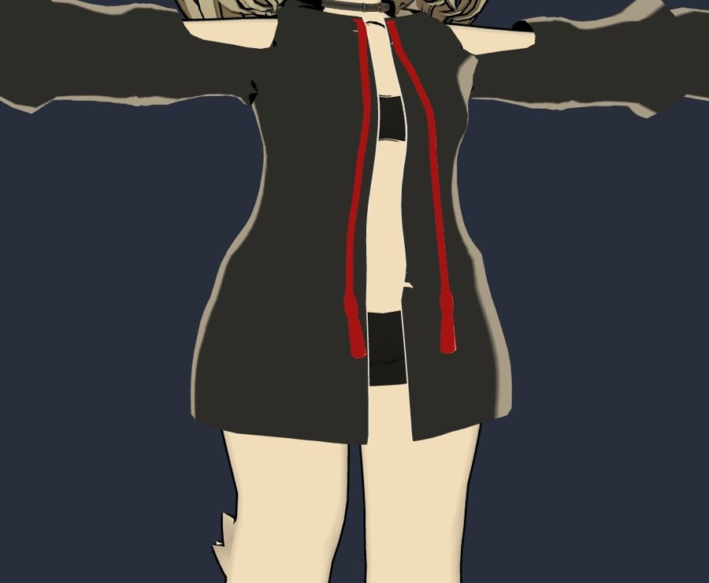
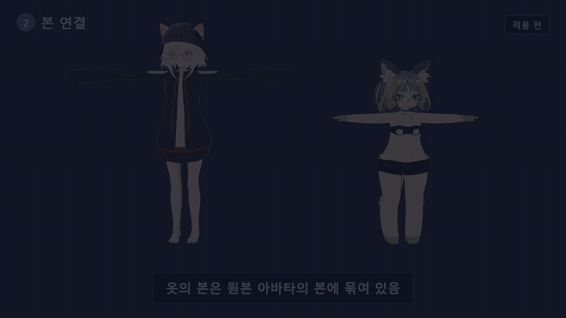
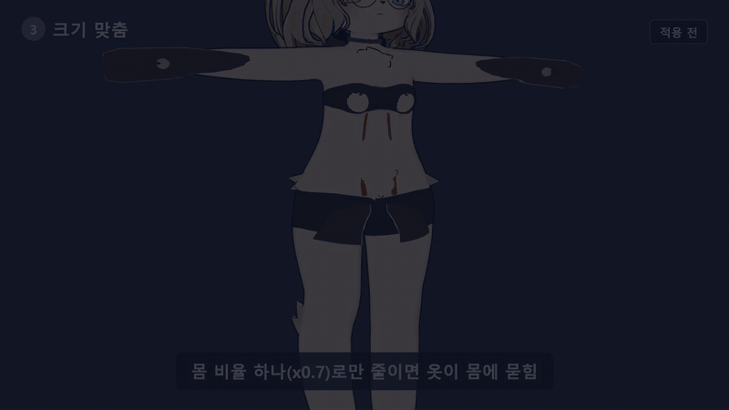
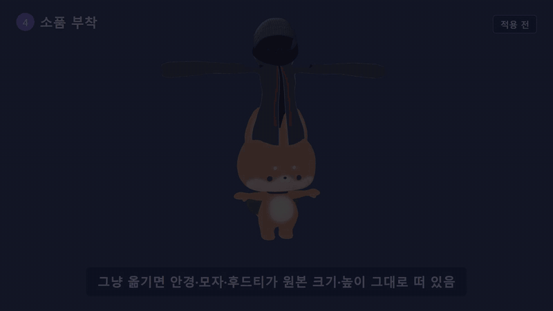
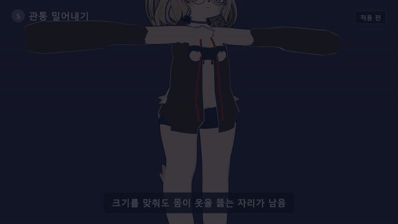
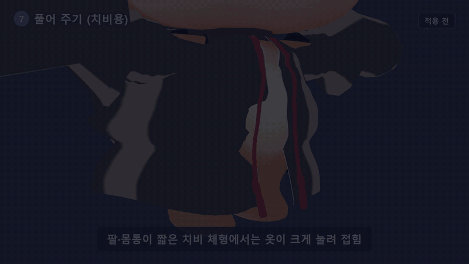
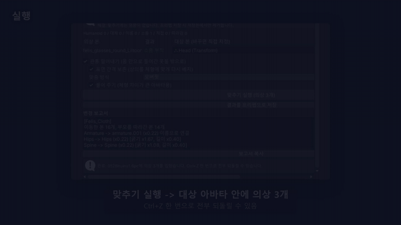
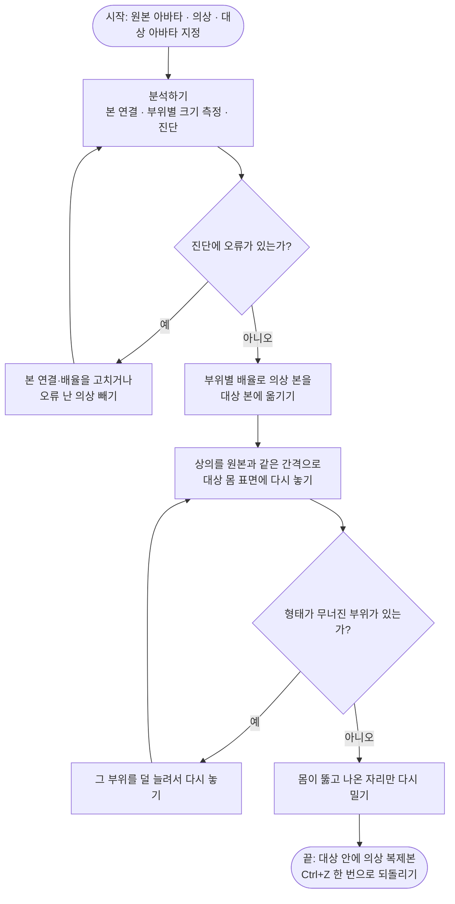

# Outfit Grader

한 아바타 전용 의상·소품을 **체형이 전혀 다른 아바타**에 옮겨 입히는 Unity 에디터 도구입니다.


- 지원 범위: **모자·상의·안경** (손 소품·하의·신발은 다루지 않음)
- Unity 2022.3 LTS, 외부 패키지 없음 (Unity 기본 API만 사용)
- EditMode 테스트 211개 통과 (2026-11-25)

## 왜 만들었나

VRChat 아바타 의상 변환 도구(예: きせった Kisetter)의 사용자 후기에서 반복된 불편을 직접 해결해 보려고 만든 축소판입니다. 이름은 기준 패턴을 사이즈별로 늘리고 줄이는 의류 업계의 그레이딩(grading)에서 따왔습니다(이전 이름: Mini Outfit Fitter).

| 후기에서 나온 불편 | 이 도구의 대응 |
|---|---|
| 오류 문구가 내부 용어라 원인을 모름 | 실행 전에 문제 / 원인 / 해결 방법을 한국어로 안내 |
| 모자·안경 같은 머리 부착물이 깨짐 | 머리 구역을 따로 재고, 얼굴 앞면 기준으로 배치 |
| 체형 차이로 옷이 몸에 묻힘 | 팔·몸통 마디마다 굵기를 재고, 원본 몸과의 간격을 그대로 옮김 |
| 변환 후 위치를 고칠 수 없음 | 본 연결 표와 배율 슬라이더로 직접 수정, Ctrl+Z 한 번으로 되돌리기 |

## 핵심 결과

| 문제 | 비교 기준 -> 기본 설정 | 대상 |
|---|---|---|
| 몸에 묻힌 후드티 정점 (목 아래) | 몸 비율 하나로만 줄였을 때 2,700 -> 32 | 세미케모형 (Lumelana) |
| 몸·속옷이 뚫고 나온 후드티 삼각형 | 관통 밀어내기만 썼을 때 293 -> 86 (남은 86개는 모두 머리카락 아래 후드) | 세미케모형 (Lumelana) |
| 머리 안에 묻힌 모자 정점 | 관통 보정 없이 217 -> 4 | 치비 마스코트형 (inuinu) |
| 의상 6개를 두 아바타에 맞추는 시간 | 약 530ms (3회 중앙값) | |

| 보정 끔 | 기본 설정 |
|---|---|
|  |  |

## 기능

처리 순서대로 정리했습니다. GIF는 1.5배속이며, 빨간 점은 몸 안에 묻힌 옷 정점(목 아래)입니다. 전체 영상(2분 5초, 소리 없음)은 [`docs/videos/outfit-grader-explain.mp4`](docs/videos/outfit-grader-explain.mp4)에 있습니다.

### 1. 실행 전 진단

문제마다 문제 / 원인 / 해결 방법을 보여 주고, 오류가 있으면 실행 버튼을 잠급니다.


### 2. 본 연결

Humanoid 매핑 -> 이름 정규화(VRoid `J_Bip_L_UpperArm`, Mixamo `LeftArm`, MMD `左腕`, Blender `UpperArm.L`) 순서로 의상 본을 대상 본에 연결합니다. 대상에 없는 손가락 본은 손 본에, 치마·리본 같은 의상 전용 본은 부모 본을 따라 옮깁니다.



### 3. 크기 맞춤

몸·머리를 따로 재고(치비는 몸은 작고 머리는 큼), 상의가 덮는 팔·몸통 마디마다 굵기와 길이를 재서 따로 맞춥니다.



### 4. 소품 부착

본 없는 안경·모자를 머리 구역 안 같은 상대 위치로 옮기고, 원본에서 얼굴 앞면과 떨어져 있던 간격을 유지합니다.



### 5. 관통 밀어내기

몸 표면 안쪽에 남은 옷 정점을 바깥으로 밀어낸 새 메시로 교체합니다(원본 메시는 그대로). 모자는 두상에 맞추고, 귀·꼬리가 지나가는 자리에 구멍을 내며, 옷에 가려지는 털 묶음은 숨깁니다.



### 6. 표면 간격 보존

상의 정점을 원본 몸과 떨어져 있던 간격 그대로 대상 몸 표면 기준으로 다시 놓습니다. 셔츠 위 겉옷처럼 겹친 층의 순서가 지켜집니다.


### 7. 풀어 주기 (치비용, 기본 끔)

팔·몸통이 짧은 아바타에서 크게 눌린 접힘을 펴고, 아랫단은 엉덩이까지만 늘입니다.



### 8. 대상에 바로 입히기 · 여러 의상 한 번에

의상 복제본을 대상 아바타 안에 넣고(원본 의상은 그대로), 여러 의상을 한 번에 입힌 뒤 Ctrl+Z 한 번으로 전부 되돌립니다.




### 9. 직접 수정 · 프리팹 저장

본 연결 표에서 대상 본을 바꾸거나 측정한 몸·머리 배율에 조정 배율(0.5~2배)을 곱할 수 있습니다. 결과는 `Assets/OutfitGrader_Output/`에 새 프리팹으로 저장합니다(씬의 아바타와 원래 프리팹은 그대로).


## 사용법

1. 원본 아바타와 대상 아바타를 씬에 놓습니다. 둘 다 Humanoid로 설정되어 있어야 합니다.
2. `Tools > Outfit Grader`를 엽니다.
3. **원본 아바타**, **의상**(원본 아바타에 입힌 모자·상의·안경 오브젝트, 여러 개 가능. 프리팹 에셋은 원본 아바타 안에 먼저 놓습니다), **대상 아바타**를 지정합니다.
4. 진단과 본 연결 표를 확인하고, 필요하면 대상 본이나 배율을 고칩니다.
5. **맞추기 실행**을 누르면 대상 아바타 안에 의상이 들어갑니다. 결과가 마음에 들지 않으면 Ctrl+Z 한 번으로 되돌립니다.
6. 마음에 들면 **결과를 프리팹으로 저장**을 누릅니다.

## 동작 원리

옷을 체형이 다른 아바타에 맞출 때 핵심은 세 가지입니다. **부위마다 크기를 따로 재고**, **원본 몸과 떨어져 있던 간격을 그대로 옮기고**, **형태가 무너지는 부위는 덜 맞춥니다**.



| 핵심 | 어떻게 |
|---|---|
| 부위별 크기 측정 | 몸·머리·팔/몸통 마디의 크기를 따로 재서, 마디마다 길이와 굵기 배율을 따로 적용 |
| 표면 간격 보존 | 몸을 원통 모양 표(축 방향 16칸 x 둘레 24칸)로 재고, 옷 정점을 `대상 표면 + 여유 간격 + 원본 간격 x 굵기 비율` 위치에 다시 놓음 |
| 형태 검사 | 3배 이상 눌린 면이 부위의 15%를 넘으면 그 부위를 덜 늘려 다시 놓음(최대 4번). 형태 보존이 몸에 딱 맞추기보다 우선 |
| 겹침 정리 | 몸 메시의 변이 실제로 뚫고 지나간 옷 삼각형만 찾아 다시 밀기(최대 12번) |

## 문제 해결 사례

코드로 만든 테스트 아바타에서는 통과했지만 실제 BOOTH 모델에서 드러난 문제 10건을 원인부터 확인해 고치고, 각각 재현 테스트를 추가했습니다. 그중 세 가지입니다.

| 문제 | 원인 | 해결 | 결과 |
|---|---|---|---|
| 치비 아바타의 머리 비율이 최솟값 0.05로 잘림 | FBX 단위 때문에 Armature 스케일이 100인데, `BakeMesh`가 이를 반영하지 않은 좌표를 줌 | 본 행렬 x 바인드포즈로 정점 위치를 직접 계산 | 머리 폭 0.0044m -> 0.436m |
| 후드 위에 쓴 모자가 대상에서 후드 안으로 들어감 | 의상마다 자기 자신만 빼고 머리를 재서, 후드티와 모자의 머리 비율이 서로 다름 | 머리는 원본을 입은 그대로 한 번만 재서 모든 의상이 같이 씀 | 후드 x1.36 · 모자 x0.96 -> 둘 다 x0.96 |
| 후드티가 아래로 수 미터 늘어남 | 원본의 Hips와 Spine 본이 1mm 차이라 Hips 길이 비율이 20배로 튐 | 짧은 마디는 길이 대신 몸 비율을 씀 | Hips 길이 비율 20.00 -> 0.70 |

## 한계와 다음 단계

- **체형 차이가 아주 큰 치비 저폴리 아바타**: 형태를 지키느라 소매가 팔보다 길게 남고(팔의 1.81배), 정면에서 엉덩이 앞 몸 볼록이 열린 앞판 가장자리를 뚫어 보입니다.
- **이름 규칙에 기대는 부분**: 귀·꼬리·털은 본 이름(ear·tail·fur 등)으로 찾으므로, 규칙에 맞지 않는 이름이면 구멍을 내거나 털을 숨기지 않습니다.
- **확인하지 않은 경우**: 블렌드쉐이프로 바꾼 체형과, 셔츠 위 후드티처럼 여러 겹을 함께 옮기는 경우는 확인하지 않았습니다.
- **의상 빼기**: Modular Avatar 없이 의상 본을 대상 본 아래로 직접 옮기므로, 빼려면 Ctrl+Z를 쓰거나 옮겨진 오브젝트(`<본>_<의상>`)를 함께 지워야 합니다.
- **다음 단계**: VRChat SDK·Modular Avatar 연동(Merge Armature 형식 출력), 대상의 눈 본을 높이 기준으로 사용, UI 일본어 전환

## 실행 환경과 테스트

- Unity 2022.3 LTS (개발 2022.3.62f3, VRChat 기준 버전 2022.3.22f1과 같은 LTS)
- EditMode 테스트는 Unity Test Runner에서 실행하거나 명령줄로 실행합니다.

```powershell
& "C:\Program Files\Unity\Hub\Editor\2022.3.62f3\Editor\Unity.exe" -batchmode -projectPath . -runTests -testPlatform EditMode -testResults results.xml
```

## 시연 모델

모델 파일은 저장소에 포함하지 않습니다. 각자 BOOTH에서 받아 사용하세요.

| 모델 | 제작 | BOOTH |
|---|---|---|
| フェリス | リュクらぼ | [5385176](https://booth.pm/ja/items/5385176) |
| Lumelana | Murixir workshop | [6488991](https://booth.pm/ja/items/6488991) |
| inuinu いぬいぬ | zuchicorn | [3853613](https://booth.pm/ja/items/3853613) |
| フリーサイズニット帽 | TRIM | [4440594](https://booth.pm/ja/items/4440594) |
| フェリスちゃん用メガネ | MT-Shop | [5651914](https://booth.pm/ja/items/5651914) |
